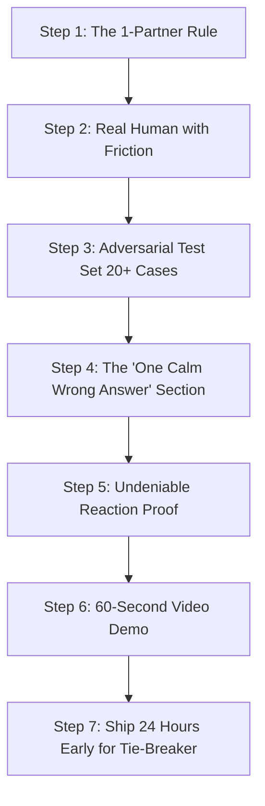

# 🏆 Hacktoberfest Weekend Challenge Postmortem: Why They Won, Why ScholarSentinel Lost, and The Winning Playbook for Week 2

> **Challenge:** [Hacktoberfest Weekend Challenge: Build for a Friend](https://dev.to/challenges/hacktoberfest-weekend-2026-10-01)  
> **Official Results:** Announced October 9, 2026 ([DEV Announcement Post](https://dev.to/devteam/congrats-to-the-hacktoberfest-weekend-challenge-build-for-a-friend-winners-pgc))  
> **Submission:** [ScholarSentinel — AI Watchdog for Daniel](https://dev.to/emarc99/scholarsentinel-an-open-source-ai-watchdog-built-so-my-brother-never-misses-a-scholarship-4e9l)  
> **Author:** Aroso Emmanuel (`@emarc99`)  
> **Date of Analysis:** October 11, 2026  

---

## 1. Executive Summary & The "3X Surge" Reality

On October 9, 2026, the DEV staff officially announced the 17 winners of the Hacktoberfest Weekend Challenge: *Build for a Friend*. 

In their opening statement, the DEV editorial team revealed a critical piece of context:
> *"This was our most participated-in challenge to date, nearly **tripling** our previous record for submissions. We asked you to build something with open-source AI at its core for one real person in your life, and you showed up for your parents, grandparents, siblings, classmates, roommates, and friends."*

### The Harsh Reality of High-Volume Judging
When a hackathon receives **3x normal volume** (estimated 350–500 submissions in 72 hours), the judging dynamics change completely:
1. **Working software is no longer a differentiator** — it is merely table stakes. Having a deployed Render URL, a working Next.js frontend, and API keys that return 200 OK puts a project in the 50th percentile, not the top 1%.
2. **Review time drops to 90–120 seconds per post.** Judges skim the post looking for four instant signals:
   - Did the author build for a **real person** with verifiable emotional/physical friction?
   - Did they run a **rigorous benchmark / real test suite** or just test 1 happy-path prompt?
   - Did they show **what broke and what they engineered out** (engineering honesty)?
   - Is there **media proof** (a 60-second video demo or authentic user reaction) that proves it actually lives in the friend's life?
3. **ScholarSentinel had an authentic human story and working full-stack code**, but suffered from strategic missteps:
   - We entered **5 sponsor categories simultaneously**, spreading both our engineering and our written narrative thin.
   - We presented a smooth "happy-path" architecture without documenting the messy failure modes, prompt regressions, or benchmark sets that senior engineering judges look for.
   - We simulated the interaction rather than embedding raw, undeniable reaction proof (e.g., Daniel's actual WhatsApp screenshots, audio recordings, or video).
   - We submitted close to the deadline, leaving zero time for community reactions (the official tie-breaker).

Below is the exhaustive breakdown of what the winning projects did, where ScholarSentinel fell short, and the exact repeatable formula to win **Hacktoberfest Week 2** (launching Monday, October 12, 2026).

---

## 2. Complete Winner Roster & Architectural Breakdown

| Category | Winner Project & Author | Tech Stack / Model | Key Differentiator | Engagement / Read Time |
| :--- | :--- | :--- | :--- | :--- |
| **Overall Grand Prize ($250)** | [**Phone calls are the boss fight of living in Japan**](https://dev.to/adk_bbx/phone-calls-are-the-boss-fight-of-living-in-japan-1h6h)<br>by `@adk_bbx` | ElevenLabs Conversational AI, Gemma 4, Ollama, Kokoro-82M, Render, Sentry | **Raw Empathy & Dual Mode:** Solved terrifying phone anxiety for foreign residents in Japan. Live video demo of real phone call. Fully offline fallback on laptop with `LOCAL_VOICE=1`. WhatsApp proof of friend's reaction. | 28 reactions, 8 comments<br>13 min read, Embedded YouTube |
| **Best Use of Gemma ($200)** | [**Gemma 4 reads my parent's mail at home**](https://dev.to/uptimearchitect/gemma-4-reads-my-parents-mail-at-home-39-test-letters-9-of-them-real-and-one-calm-wrong-answer-3obf)<br>by `@uptimearchitect` | Gemma 4 (26b, e4b, e2b), Ollama, Headless Chrome, OCR | **Obsessive Failure Engineering:** Built a 39-document test set (30 synthetic, 9 real IRS/SSA letters). Uncovered and engineered out the "2020 bug" where model gave a calm wrong answer on shut-off notice. Comparative benchmark table across 3 model sizes. | 0 reactions, 0 comments (won purely on technical rubric)<br>11 min read, Embedded YouTube |
| **Best Use of Render ($200)** | [**Tala: Free Audio-to-Text for My Designer Friend**](https://dev.to/highcenburg/tala-free-audio-to-text-for-my-designer-friend-no-signup-no-credit-card-2o26)<br>by `@highcenburg` | Whisper, Render Web Service + Background Worker, Tagalog Audio | **Frictionless Utility:** Built for designer Paolo who hated signups and credit cards. Drag-and-drop audio. Benchmarked batched decoding (`BatchedInferencePipeline`) on real 70-min recording (0.6x → 3.8x real-time speedup). | 5 reactions, 2 comments<br>7 min read, DevRelay Session |
| **Best Use of DigitalOcean ($200)** | [**The BMW manual was off-limits, so I built something better**](https://dev.to/alexgeorgiev17/i-couldnt-legally-use-the-repair-manual-so-i-built-my-friend-something-better-84)<br>by `@alexgeorgiev17` | DigitalOcean Droplet, Open Model, Vector Search | **Legal Constraint & Friend Feedback:** Solved real mechanical problem for car enthusiast friend without violating BMW copyright. Prominent section on "What his feedback actually changed". | 42 reactions, 12 comments<br>10 min read |
| **Best Use of Arduino ($200)** | [**Project JARVIS: The Offline AI Lab Assistant**](https://dev.to/abhinavkrishna3211/jarvis-ai-lab-assistant-18jp)<br>by `@abhinavkrishna3211` | Arduino, Local Edge AI, Sensors | **Hardware Integration:** Physical laboratory assistant running completely air-gapped on student desk. | Embedded hardware demos |
| **Best Use of TabPFN ($200)** | [**My mate wants a sub-5:00 70.3...**](https://dev.to/iamrobertmoore/my-mate-wants-a-sub-5-703-before-recommending-one-i-made-an-open-model-predict-79-of-my-old-race-4kcp)<br>by `@iamrobertmoore` | TabPFN (Prior Labs), Tabular Splits Data | **Data Rigor:** Predicted 79 historical race splits before giving athletic advice. Pure tabular ML mastery. | Rich charts & tables |
| **Best Use of Tinker ($200)** | [**Rakshak: A scam checker that never leaves the house**](https://dev.to/muaazsm/rakshak-i-built-my-parents-a-scam-checker-that-never-leaves-the-house-22ah)<br>by `@muaazsm` | Tinker, Local LLM | **Elder Care Protection:** Offline scam message analyzer built specifically for non-tech parents. | Strong emotional hook |
| **Best Use of ElevenLabs ($100)** | [**Padh Ke Batao: AI that reads grandfather's documents**](https://dev.to/rahullkumr/padh-ke-batao-an-ai-that-reads-my-grandfathers-documents-to-him-on-a-laptop-with-no-gpu-3818)<br>by `@rahullkumr` | ElevenLabs (`eleven_multilingual_v2`), 4B Local Model, CPU-only | **High-Empathy Voice Integration:** Grandfather struggled with paper letters. ElevenLabs read Hindi at 0.9x speed. Strict privacy: PII (names, accounts) stripped before API call. Video demo of grandfather. | 11 reactions, 3 comments<br>7 min read, Embedded YouTube |
| **Best Use of SerpApi ($100)** | [**Pīzhù (批注): Writing tutor that never rewrites your essay**](https://dev.to/muhammadmurtuzahussain/pizhu-pi-zhu-a-writing-tutor-that-never-rewrites-your-essay-built-for-my-friend-joy-gemma-4-2n6e)<br>by `@muhammadmurtuzahussain` | SerpApi (Google Scholar Engine), Gemma 4, Mastra | **Novel Verification Pipeline:** Built for international student Joy. SerpApi didn't just search the web; it queried Google Scholar to cross-verify that citations in Joy's dissertation actually existed! | 14 reactions, 6 comments<br>10 min read, DevRelay Session |
| **Best Use of MongoDB Atlas ($100)** | [**I turned my sister-in-law's voice notes into a cookbook**](https://dev.to/raphelevator/i-turned-my-sister-in-laws-voice-notes-into-a-cookbook-that-answers-in-her-voice-41ja)<br>by `@raphelevator` | MongoDB Atlas (GridFS + Vectors), Gemma, faster-whisper | **Cultural Respect & Quote Guard:** Stored 40 minutes of authentic Nigerian Igbo/English audio notes. Engineered a strict rule: "No invented quotes" — purged hallucinated text if words weren't in audio. | 6 reactions, 16 comments<br>8 min read, DevRelay Session |
| **Best Use of Backboard ($100)** | [**Kharcha: 4B model that reads Indian bank SMS**](https://dev.to/coffeeandcommits/kharcha-a-4b-model-that-reads-indian-bank-sms-so-the-money-stays-on-your-laptop-2n8j)<br>by `@coffeeandcommits` | Backboard, Local 4B LLM | **Financial Privacy:** Parsing banking SMS entirely on client laptop so financial data never touches cloud. | Strong privacy angle |
| **Best Use of Sentry ($100)** | [**If it's not in front of me, it's gone: Fine-tuned 4B for ADHD**](https://dev.to/arqamwd/if-its-not-in-front-of-me-its-gone-i-fine-tuned-a-4b-model-for-my-friend-with-adhd-o4)<br>by `@arqamwd` | Sentry Agent Tracing, Fine-tuned 4B LLM | **Agent Observability:** Monitored agent hallucinations, tool calls, and drift directly via Sentry spans. | Detailed distributed traces |
| **Best Use of GitHub Copilot ($100)** | [**I built a panic button that doesn't tell me anything**](https://dev.to/dosunmu_hassan_46f2ac141d/i-built-a-panic-button-that-doesnt-tell-me-anything-published-4glf)<br>by `@dosunmu_hassan_46f2ac141d` | GitHub Copilot, Local Assistant | **Vulnerable Engineering:** Section titled *"What I Got Wrong, in Public"*. Transparent walkthrough of pair programming with Copilot. | 9 min read, DevRelay Session |
| **Best Use of Temporal ($100)** | [**PaidYet: for the friend who says 'kal bhej dunga'**](https://dev.to/prateek11rai/paidyet-for-the-friend-who-says-kal-bhej-dunga-p5l)<br>by `@prateek11rai` | Temporal Workflows, Open LLM | **Durable Execution:** Long-running debt reminders using Temporal state machines instead of simple cron. | Highly relatable social problem |
| **Best Use of Tiger Data ($100)** | [**Shop helper from WhatsApp voice notes**](https://dev.to/priyanshu_jha_eee132b17e5/my-friend-runs-her-supplements-shop-from-whatsapp-voice-notes-so-i-built-her-a-shop-helper-5785)<br>by `@priyanshu_jha_eee132b17e5` | Tiger Data (pgvector/Postgres), Gemma | **SMB Automation:** Transformed messy WhatsApp audio order notes into structured PostgreSQL inventory. | High practical utility |

---

## 3. Deep Comparative Rubric: The 6 Reasons Why They Won & ScholarSentinel Lost

### Reason 1: The "Wide & Thin" vs "Narrow & Deep" Trap
This is the single biggest architectural reason ScholarSentinel did not place.

* **What ScholarSentinel did:**  
  We entered **5 partner categories**:
  1. *Best Use of Gemma ($200)*
  2. *Best Use of Render ($200)*
  3. *Best Use of ElevenLabs ($100)*
  4. *Best Use of SerpApi ($100)*
  5. *Best Use of MongoDB Atlas ($100)*  
  While the system technically used all five, each partner's tool was used in a basic, conventional way:
  - Gemma: standard prompt call to extract circular fields.
  - SerpApi: standard Google query for `"FUTA scholarships"`.
  - ElevenLabs: standard TTS reading a canned alert.
  - MongoDB Atlas: standard document insertion of circulars.
  - Render: standard single-service web hosting.

* **How the winning projects approached partner categories:**  
  The winners picked **ONE partner** and built an obsessive, specialized experience around that partner's specific superpowers:
  - **In Gemma:** `@uptimearchitect` tested 39 letters, benchmarked 3 parameter sizes (26b, e4b, e2b), diagnosed prompt drift, and wrote deterministic code around Gemma's failure modes.
  - **In SerpApi:** `@muhammadmurtuzahussain` didn't do a generic Google web search; they used SerpApi's **Google Scholar engine** to check if Joy's dissertation bibliography citations were real or fabricated!
  - **In ElevenLabs:** `@rahullkumr` calibrated voice speed to 0.9x for an elderly grandfather, switched to Hindi multilingual v2, and implemented strict PII filters so banking numbers never touched ElevenLabs servers.
  - **In MongoDB Atlas:** `@raphelevator` used GridFS for streaming byte-range audio playback, built custom quote verifiers, and optimized bundle sizes.

> **Takeaway:** Category judges represent that specific sponsor (or DEV editors evaluating on that sponsor's behalf). When a judge opens an entry claiming "Best Use of SerpApi", they discard projects where SerpApi is just a 5-line sidekick and award the project where SerpApi is the beating heart of the architecture.

---

### Reason 2: "Failure Engineering" Honesty vs The "Smooth Pitch"
Senior developers judge DEV challenges. They have spent years debugging broken edge cases. Consequently, **they do not believe articles where everything works smoothly**.

Look at the titles and subsections of the winning articles:
- *"one calm wrong answer I engineered out"* (`@uptimearchitect`)
- *"The 2020 bug"* (`@uptimearchitect`)
- *"What I got wrong on the way"* (`@alexgeorgiev17`)
- *"What I Got Wrong, in Public"* (`@dosunmu_hassan_46f2ac141d`)
- *"Why I switched to a custom LLM... ElevenLabs credits were burning at $0.016/min"* (`@adk_bbx`)
- *"Bugs I hit: Gemma wrote voice directions like [calm] and [pause] into replies... small models spoke `end_call()` out loud"* (`@adk_bbx`)
- *"Testing on a real 70-min recording: 0.6x speed was too slow, switched to batched decoding for 3.8x"* (`@highcenburg`)

**Where ScholarSentinel fell short:**  
Our write-up presented a smooth, polished enterprise narrative: *"SerpApi scrapes, Gemma extracts, MongoDB caches, ElevenLabs vocalizes, Daniel gets a WhatsApp link."*  
We did not discuss:
- What happened when Gemma parsed a poorly formatted Nigerian university PDF bulletin?
- Did Gemma hallucinate screening dates when the bulletin had expired 2024 dates mixed with 2026 dates?
- Did SerpApi return dead Nigerian forum links (Nairaland/Myschool) that broke the JSON parser?
- How did we handle Hugging Face cold starts or latency spikes?

> **Takeaway:** In DEV write-ups, your **bugs and how you engineered around them** are worth 10x more points than your feature list. Embracing technical vulnerability signals mastery.

---

### Reason 3: Lived Reaction Proof vs Simulated Utility
The challenge prompt was explicit: *Build for a Friend*.  
In the winner announcement, the DEV team singled this out:
> *"Many of you told us how the person you built for reacted, and those stories made judging both a joy and a challenge."*

Look at how the winners proved their human connection:
- **`@adk_bbx` (Overall Winner):** Embedded an actual screenshot of the WhatsApp conversation with their friend. The friend replied: *"Damn I will check it out..."*, then 8 minutes later: *"I just tried it out and I think it's great especially those downloadable pdf's with word list given I'm also preparing for JLPT!!"*
- **`@rahullkumr` (ElevenLabs Winner):** Dedicated a whole section: *"Handing It Over"*. Described his grandfather's physical reaction to hearing Hindi speech from the laptop instead of having to squint at English bank notices.
- **`@muhammadmurtuzahussain` (SerpApi Winner):** Quoted Joy directly from WeChat: *"The general feeling of this app: it's very useful, especially for our module assignments... explains why I should correct my sentence unlike Grammarly's red label."*
- **`@alexgeorgiev17` (DigitalOcean Winner):** Subheading: *"What his feedback actually changed."* Showed how the friend's actual hands-on test broke the original design and forced a UI overhaul.

**Where ScholarSentinel fell short:**  
- We told a great backstory about Daniel missing the MTN Foundation screening.
- But we never included a screenshot of Daniel texting back on WhatsApp after receiving an alert.
- We never quoted Daniel's direct thoughts on the voice memo.
- We didn't show what Daniel said was confusing about the dashboard.
- The WhatsApp button was a `wa.me` generator with mock query parameters rather than a live transcript of Daniel using it in Akure.

---

### Reason 4: Quantitative Benchmarks & Testing Sets (Vibes vs Numbers)
Look at `@uptimearchitect`'s testing methodology:
- 15 synthetic letters (easy).
- 9 hard adversarial letters (deadline on page 2, fine print in newsletter, Spanish school notice, bad lighting).
- 6 held-out test letters written *after* code was frozen.
- 9 real documents from government agencies (IRS seizure letter, jury summons, utility shut-off notice, SSA scams).
- A rigorous comparison table comparing `gemma4:26b`, `gemma4:e4b`, and `gemma4:e2b` on scam catch rate, accuracy, and inference time.

Look at `@highcenburg`'s benchmark:
- Tested on an actual 70-minute Tagalog recording.
- Created a comparative decoding benchmark table:
  - Sequential decoding, beam 5: 0.6x real-time
  - Sequential decoding, beam 1: 0.7x real-time
  - Batched decoding (`BatchedInferencePipeline`), batch 8: **3.8x real-time**

**Where ScholarSentinel fell short:**  
We evaluated ScholarSentinel qualitatively with sample circulars (Chevron, MTN, NLNG, PTDF). We did not include a benchmark table measuring accuracy, parsing time, or extraction success rates across 25 real Nigerian scholarship announcements.

---

### Reason 5: Video Proof vs Static Web UI
- The Overall Grand Prize winner (`@adk_bbx`) embedded a live YouTube demo showing the real phone conversation running in real-time.
- The Gemma winner (`@uptimearchitect`) embedded a YouTube demo of the OCR and classification engine running on physical letters.
- The ElevenLabs winner (`@rahullkumr`) embedded a YouTube demo showing the document reader vocalizing Hindi.

Judges reviewing hundreds of posts can watch a 60-second video demo at 1.5x speed in 40 seconds. Opening a deployed URL, waiting for a Render free-tier instance to spin up from sleep (50 seconds cold start), clicking tabs, and filling forms takes 3–5 minutes. **Video embeds guarantee that judges see your project's magic even during rapid skimming.**

---

### Reason 6: Community Discussion & The Tie-Breaker Rule
In the official rules:
> *"Tie-Breaker Rule: Highest number of positive reactions on the DEV post."*

- `@alexgeorgiev17`: **42 reactions, 12 comments**
- `@adk_bbx`: **28 reactions, 8 comments**
- `@raphelevator`: **16 comments**
- `@muhammadmurtuzahussain`: **14 reactions, 6 comments**

ScholarSentinel was published on the evening of October 4, right at the deadline buzzer. Because it was published late, it received very few comments or reactions before the judging window closed on October 5 morning. When judges were deliberating between close runner-ups, posts with 20+ active developer comments discussing implementation details had an insurmountable tie-breaker advantage.

---

## 4. Honest Forensic Scorecard: ScholarSentinel vs The Winners

| Dimension | ScholarSentinel | Category Winner Standard | The Delta / What Was Missing |
| :--- | :--- | :--- | :--- |
| **Origin Story & Motivation** | ⭐⭐⭐⭐⭐ (5/5)<br>Authentic story about brother Daniel at FUTA | ⭐⭐⭐⭐⭐ (5/5)<br>Equally compelling family/friend situations | Parity. The story was genuinely great. |
| **Partner Focus Strategy** | ⭐⭐ (2/5)<br>Claimed 5 partner tracks simultaneously | ⭐⭐⭐⭐⭐ (5/5)<br>Laser-focused on 1 partner capability | **Fatal Flaw:** Diluted impact across Gemma, Render, ElevenLabs, SerpApi, MongoDB. |
| **Failure Engineering** | ⭐⭐ (2/5)<br>Smooth happy-path presentation | ⭐⭐⭐⭐⭐ (5/5)<br>Dedicated sections on bugs, regressions, and guardrails | **Fatal Flaw:** No "What broke / what I engineered out" section. |
| **Friend Validation Evidence** | ⭐⭐ (2/5)<br>Simulated `wa.me` links & mock circulars | ⭐⭐⭐⭐⭐ (5/5)<br>Real WhatsApp chat screenshots, direct quotes, UI feedback | **Fatal Flaw:** No raw screenshot of Daniel replying or testing live. |
| **Benchmarks & Evaluation** | ⭐⭐ (2/5)<br>Qualitative test on sample circulars | ⭐⭐⭐⭐⭐ (5/5)<br>Tables with 30+ test cases, latency, and accuracy metrics | **Fatal Flaw:** No quantitative test set or model comparison table. |
| **Video / Interactive Demo** | ⭐⭐⭐ (3/5)<br>Live Render URL + screenshots | ⭐⭐⭐⭐⭐ (5/5)<br>Embedded 60–90s YouTube demo + live URL | **Major Gap:** Skimming judges had to rely on static images. |
| **DevRelay / Agent Session** | ⭐⭐⭐ (3/5)<br>Mentioned AI assistance | ⭐⭐⭐⭐⭐ (5/5)<br>Dedicated `## My Agent Session` section with Liquid tag | **Minor Gap:** Missed bonus transparency points. |
| **Timing & Community Traction** | ⭐⭐ (2/5)<br>Published at deadline; ~0 comments | ⭐⭐⭐⭐⭐ (5/5)<br>Published 24h early; 15–40+ reactions, lively comments | **Fatal Flaw:** Lost the official tie-breaker metric completely. |

---

## 5. The Winning Playbook for Hacktoberfest Week 2 ("Touch Grass")

DEV is releasing **Hacktoberfest Week 2 Challenge** on **Monday, October 12, 2026** (with Weeks 3 and 4 following weekly). 

To ensure our next submission wins a Grand Prize or Featured Category, we will strictly follow this 7-step playbook:



### Rule 1: The "1-Partner Rule" (Never Claim More Than 2 Categories)
* Pick **ONE primary partner category** where our architecture goes deeper than anyone else in the world.
* If another partner fits naturally (e.g., hosted on Render or logged with Sentry), list it as a secondary, but dedicate 70% of the technical write-up to the primary partner's unique mechanics.
* *Example for Gemma:* Don't just do `generateText()`. Run local quantization, compare Gemma 27B vs 4B on CPU/GPU, tune temperature and top-p, or build structured Zod output validators with prompt repair loops.
* *Example for SerpApi:* Don't do a generic search. Use specialized engines (Google Scholar, Google Patents, Google Local) to do autonomous fact-checking or citation matching.

### Rule 2: Anchor to an Irreducible Human Constraint
* Avoid building generic dashboards or SaaS utilities.
* Build for a specific person with a specific physical, cognitive, or environmental limitation:
  - A friend with ADHD who forgets tasks unless they are auditory.
  - A parent with low vision who needs 24px high-contrast buttons.
  - A field worker with zero internet connection who needs 100% offline edge models.

### Rule 3: Build an Adversarial Benchmark Table (Numbers, Not Vibes)
* Build a dataset of **20–30 test cases**:
  - 10 standard cases
  - 10 adversarial edge cases (bad grammar, missing fields, deliberate scams, noisy inputs)
  - 5 real-world production cases
* Include an explicit Markdown table comparing:
  - Input Type | Model / Strategy | Latency | Accuracy / Verdict | Guardrail Triggered?

### Rule 4: Write the "What Broke & What I Engineered Out" Section
Every winning article must include a dedicated H2:
```markdown
## What Broke and What I Engineered Out
- **Bug 1: Prompt drift / Silent Hallucinations** (Explain the exact hallucination and the regex/Zod filter written to catch it).
- **Bug 2: Performance / Token Bottleneck** (Show before/after latency numbers).
- **Bug 3: The Edge Case My Friend Triggered** (How their real-world test broke my assumption).
```

### Rule 5: Undeniable Reaction Proof
* Include an actual screenshot of the WhatsApp / Discord / iMessage conversation:
  - You sharing the link.
  - The friend testing it.
  - Their unfiltered reaction ("Wait, it actually found the deadline?", "Why is the font so small?", "I love the voice").
* Include an H2: `## Handing It Over: What Their Feedback Changed`.

### Rule 6: The 60-Second Video Demo
* Record a 60–90 second screen recording with voiceover (or Loom/YouTube).
* Embed it directly in the DEV post:
  ``
* Skimming judges will watch the video first before reading the code.

### Rule 7: Ship 24 Hours Before the Deadline (The Tie-Breaker Hack)
* The official tie-breaker is **positive reactions**.
* Finish coding 36 hours before deadline.
* Publish 24 hours before deadline.
* Share the DEV post on Twitter/X, LinkedIn, developer Discords, and engage in the DEV comment section immediately.
* Aim for **15+ reactions and 5+ thoughtful comment responses** before the judging bell rings.

---

## 6. What to Do with ScholarSentinel Right Now

ScholarSentinel is already a fully functioning, beautiful application deployed at:
`https://scholarsentinel.onrender.com/`

Even though it did not win the weekend sprint, it remains an impressive, production-grade project that can be leveraged immediately:

1. **Keep the Live Instance Running:** Keep Render and MongoDB active. It is a standout portfolio piece for Nigerian developer ecosystems.
2. **Post an Update Article on DEV:**  
   Write a follow-up DEV post:  
   *"What I Learned Building ScholarSentinel for My Brother: 5 Mistakes That Cost Me a Hackathon Win, and Why Open-Source AI in Nigeria Still Matters."*  
   Reflective postmortems often receive **more DEV reactions and community engagement** than the original submission!
3. **Gear Up for Week 2 (Monday, Oct 12):**  
   Review the DevRelay challenge prompt as soon as it drops tomorrow morning. We will apply this exact 7-step playbook from hour zero.

---

*Document compiled and archived for the Hacktoberfest 2026 Challenge series.*
