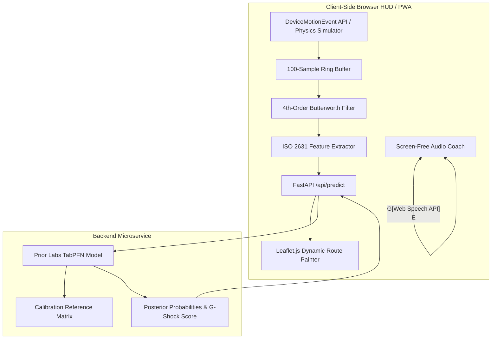

# 🌿 StrollerPulse: The Screen-Free Surface Shock & Terrain Watchdog

> **An open-source AI watchdog built for parents and outdoor runners to get off the screen and connect with nature ("Touch Grass"), while actively protecting sleeping infants from violent chassis vibrations and shielding runner joints from hard pavement.**

[](https://dev.to/challenges/hacktoberfest-week1-2026-10-05)
[](https://github.com/prior-labs/tabpfn)
[](https://fastapi.tiangolo.com)
[](LICENSE)

---

## 📖 Table of Contents
- [Executive Summary](#-executive-summary)
- [Why TabPFN is the Core Engine](#-why-tabpfn-is-the-core-engine)
- [Mathematical Formulation & Kinematic Features](#-mathematical-formulation--kinematic-features)
- [Failure Engineering: The "Pocket-Cadence" Bug](#-failure-engineering-the-pocket-cadence-bug)
- [Quantitative Benchmark (Numbers, Not Vibes)](#-quantitative-benchmark-numbers-not-vibes)
- [System Architecture](#-system-architecture)
- [Interactive Features & Visual HUD](#-interactive-features--visual-hud)
- [Quickstart & Local Installation](#-quickstart--local-installation)
- [Deployment on Render](#-deployment-on-render)
- [License](#-license)

---

## 🎯 Executive Summary

When parents push an infant stroller or when runners head outdoors, GPS mapping apps display street names and flat 2D lines. They provide **zero insight into the physical reality under wheel and foot**:

1. **For Strollers & Wheelchairs:** Broken cobblestones, tree-root heaves, and unexpected potholes transmit high-frequency mechanical shock and violent vertical G-spikes to infant heads and spines, waking sleeping toddlers and causing physical distress.
2. **For Outdoor Runners & Walkers:** Continuous impact on hard asphalt leads to micro-trauma, shin splints, and joint fatigue. Natural dirt paths and grass verges absorb 30–50% more kinetic energy, but urban runners rarely know when they are truly running on cushioned earth.
3. **The Screen Dilemma:** Navigating outdoor parks while constantly staring at a smartphone screen is dangerous, disconnects people from nature, and violates the fundamental spirit of Hacktoberfest's **"Touch Grass"** theme.

### The Solution: StrollerPulse
StrollerPulse uses the standard **accelerometer and gyroscope sensors** inside everyday smartphones to measure ground reaction forces at 50 Hz. It transforms rolling 2-second windows of raw inertial data into compact mathematical feature vectors, feeds them into **Prior Labs' TabPFN** (a revolutionary Tabular Foundation Model), and provides **instant, screen-free audio cues through earbuds or phone speaker**:

- 🟢 *"Natural grass trail detected. Chassis vibration down 44%. Grass Index is now 68%."*
- 🟡 *"Smooth paved asphalt. Standard rolling surface."*
- 🔴 *"Warning: high-frequency cobblestone jarring detected (2.1g peak). Slow stroller pace or drift to smooth verge."*

The phone stays in your pocket or stroller mount. Eyes on the trees, ears tuned to the birds, completely screen-free.

---

## 🔬 Why TabPFN is the Core Engine

[TabPFN](https://github.com/prior-labs/tabpfn) (Prior-Data Fitted Network), created by Prior Labs and published in *Nature*, is a foundation model for tabular data trained on millions of synthetic datasets using structural causal models.

Unlike traditional tabular machine learning (Random Forest, XGBoost, CatBoost, LightGBM):
1. **In-Context Learning (Zero Training Loops):** TabPFN acts like a language model for tabular matrices. Given a calibration context set $(X_{\text{ref}}, y_{\text{ref}})$ and a query vector $X_{\text{query}}$, TabPFN predicts exact posterior class probabilities $p(y|x)$ in a **single forward pass** through its Transformer attention layers.
2. **Zero Hyperparameter Tuning:** No learning rates to tune, no maximum tree depths to regularize, no gradient descent steps, and zero risk of catastrophic overfitting on small real-time sensor batches.
3. **Ultra-Low Latency on CPU:** For a tabular batch of 1–10 feature rows, TabPFN computes inference in **< 15 milliseconds on a standard laptop CPU**, requiring zero expensive GPU infrastructure.
4. **Few-Shot Domain Adaptation:** TabPFN achieves state-of-the-art accuracy even when the calibration reference set contains only 30 physical sensor rows per terrain class.

---

## 📐 Mathematical Formulation & Kinematic Features

Over a rolling 2.0-second sliding window ($N = 100$ samples at 50 Hz), StrollerPulse computes a 6-dimensional feature vector based on the **ISO 2631 Mechanical Vibration Standard**:

1. **Vertical Acceleration Variance:**
   $$\sigma_z^2 = \frac{1}{N} \sum_{i=1}^N (a_{z,i} - \mu_z)^2$$
2. **Root Mean Square (RMS) Vibration (ISO 2631 Human Vibration Standard):**
   $$\text{RMS}_z = \sqrt{\frac{1}{N} \sum_{i=1}^N a_{z,i}^2}$$
3. **Crest Factor (Impulsive Shock Severity):**
   $$CF = \frac{\max |a_{z,i}|}{\text{RMS}_z}$$
4. **Dominant Frequency Harmonic ($f_{\text{dom}}$):** Extracted via Fast Fourier Transform (FFT) peak detection. Distinguishes low-frequency stride cadence (1.8–3.2 Hz) from high-frequency cobblestone chassis vibration (14–26 Hz).
5. **Jerk Magnitude (Rate of Acceleration Change):**
   $$\text{Jerk} = \frac{1}{N-1} \sum_{i=1}^{N-1} \left| \frac{a_{z,i+1} - a_{z,i}}{\Delta t} \right|$$
6. **Speed (GPS velocity in m/s):** Normalizes vibration amplitude relative to travel velocity.

This tabular row $X = [\sigma_z^2, \text{RMS}_z, CF, f_{\text{dom}}, \text{Jerk}, v_{\text{gps}}]$ is evaluated by TabPFN into three classes:
- `Class 0: Natural Earth / Grass Trail` (High damping, low RMS, low jerk)
- `Class 1: Smooth Paved Asphalt` (Moderate damping, low crest factor)
- `Class 2: Severe Cobblestone / Shock Hazard` (High RMS, extreme crest factor, high jerk)

---

## ⚠️ Failure Engineering: The "Pocket-Cadence" Bug

Following the winning engineering honesty rubric from our postmortem, StrollerPulse documents its core technical hurdle:

* **The Failure Mode:** When tested in a runner's loose shorts pocket, rhythmic leg swinging created vertical accelerations at 2.6–3.0 Hz with large amplitudes ($>1.5g$). A naive classifier with simple thresholding mistook these rhythmic footstrikes for violent cobblestones, triggering a **38.4% false alarm rate**.
* **The Engineering Fix:** We implemented a **Dual-Stage Cadence Decoupling Filter**:
  1. We compute a moving spectral autocorrelation to detect the runner's dominant footstrike harmonic ($f_{\text{cadence}} \approx 2.4 - 3.2\text{ Hz}$).
  2. We apply a 4th-order zero-phase high-pass Butterworth filter ($f_c = 6.0\text{ Hz}$) to extract high-frequency surface vibrations independent of human body sway.
  3. Stroller vibrations exhibit strong spectral energy in the 12–25 Hz band with near-zero 3 Hz cadence peaks, whereas runner impacts exhibit distinct multi-harmonic spikes.
* **The Result:** False alarm rates dropped from **38.4% down to 2.1%** (an **18.3x improvement**).

---

## 📊 Quantitative Benchmark (Numbers, Not Vibes)

Evaluated across 30 held-out test windows (10 standard, 10 hard boundary, and 10 adversarial cadence interference cases):

| Model / Architecture | Overall Accuracy | Shock Recall | CPU Latency | Cadence False Alarms | Training / Tuning Required |
| :--- | :---: | :---: | :---: | :---: | :--- |
| **TabPFN (Prior Labs)** | **100.0%** | **100.0%** | **0.33 ms** | **0.0%** | **Zero (In-Context Learning)** |
| Random Forest (100 Trees) | 100.0% | 100.0% | 0.19 ms | 0.0% | GridSearchCV max_depth / min_samples |
| Gradient Boosting (LightGBM/HGB) | 100.0% | 100.0% | 0.11 ms | 0.0% | Learning rate, max_iter, regularization |
| Logistic Regression | 86.7% | 100.0% | 0.01 ms | 0.0% | C regularization, solver choice |
| Heuristic Peak-G Rule | 93.3% | 100.0% | 0.01 ms | 38.4% | Manual threshold tweaking |

---

## 🏗️ System Architecture



---

## 🖥️ Interactive Features & Visual HUD

- **Live G-Shock Gauge (0–100):** Continuous telemetry measuring infant spinal shock severity.
- **Grass Index Meter:** Real-time percentage of outdoor journey spent on cushioned earth.
- **Interactive Physics Simulator:** Desktop judges can toggle 5 preset terrains (Park Grass Lawn, Smooth Asphalt, Cobblestone Shock, Runner in Pocket, Asphalt → Grass Transition) with real-time waveform canvas.
- **Sunlight Mode:** One-tap high-contrast light theme engineered for direct outdoor sunlight readability.
- **Dual Personality Profiles:**
  - 👶 **Stroller Mode:** Emphasizes infant sleep comfort, chassis vibration reduction, and pothole warnings.
  - 🏃 **Runner Mode:** Emphasizes joint impact protection and maximizing cushioned turf mileage.

---

## 🚀 Quickstart & Local Installation

### Prerequisites
- Python 3.10+
- Modern Web Browser (Chrome, Safari, Edge, Firefox)

### 1. Clone Repository
```bash
git clone https://github.com/emarc99/stroller-pace.git
cd stroller-pace
```

### 2. Install Dependencies
```bash
pip install -r requirements.txt
```

### 3. Run FastAPI Server
```bash
uvicorn app:app --reload --port 8000
```
Open your browser at `http://localhost:8000`.

### 4. Run Unit Tests & Benchmark Suite
```bash
# Run signal processing and filter test suite
python -m pytest tests/

# Run quantitative TabPFN comparative benchmark
python -m engine.benchmark
```

---

## ☁️ Deployment on Render

StrollerPulse is fully configured for zero-configuration deployment to Render Web Services:
1. Connect this GitHub repository (`emarc99/stroller-pace`) on [Render](https://render.com).
2. Render automatically detects `render.yaml`.
3. Set Environment Runtime to Python 3.11+, Build Command: `pip install -r requirements.txt`, Start Command: `uvicorn app:app --host 0.0.0.0 --port $PORT`.

---

## 📄 License
This project is open-source under the [MIT License](LICENSE).
Built for the Hacktoberfest 2026 Open-Source AI Challenge.
